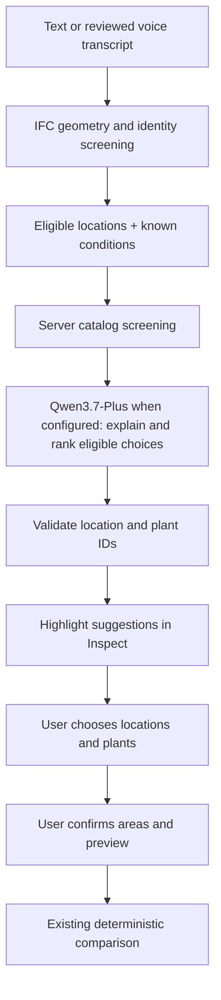

# AI assistant handoff — Task D

## Production configuration — 2026-10-15

This section supersedes the older statement that production authorization has not been implemented. The deployed entry now uses a shared demo access code and an atomic Redis quota reservation. Code is implemented and covered by offline tests. Production Redis reservation and a real Qwen response were verified through the browser on 2026-10-15; quota exhaustion and rejection cases are tested offline, not yet exercised against production. Individual accounts and exact currency accounting are not included.

In Vercel → Project → Settings → Environment Variables, select **Production** and add:

| Type | Key | Value |
|---|---|---|
| Secret | `QWEN_API_KEY` | Your provider API key |
| Config | `QWEN_BASE_URL` | `https://maas.qianwenaiapi.com/compatible-mode/v1` for the current Qwen platform key; use the matching endpoint if switching provider region |
| Config | `QWEN_MODEL` | `qwen3.7-plus` |
| Secret | `AI_DEMO_ACCESS_CODE` | A random string of 24–256 characters; share privately with demo participants |
| Config | `UPSTASH_REDIS_REST_URL` | HTTPS REST URL from a dedicated Upstash Redis database, e.g. `https://your-db.upstash.io` |
| Secret | `UPSTASH_REDIS_REST_TOKEN` | Read/write REST token from that database, not its readonly token |
| Config | `AI_REQUESTS_PER_MINUTE` | `3` (optional; default 3, allowed 1–20) |
| Config | `AI_REQUESTS_PER_DAY` | `20` (optional; default 20, allowed 1–1000) |

Create a permanent Upstash Redis database through your own account or Vercel Marketplace and copy its REST URL/token. Do not use temporary expiring storage for this demo. Keep eviction disabled and the database dedicated to this project. This task does not provision a paid service. No additional npm dependency is required: the server uses native fetch and the documented [Redis REST command interface](https://upstash.com/docs/redis/features/restapi).

Save the variables, then redeploy so the new deployment receives them. Opening AI chat and sending a question prompts for the demo access code; it is held in page memory only and clears on refresh. This code is separate from `QWEN_API_KEY`. A wrong code returns 403, quota exhaustion returns 429 with Retry-After, and storage failure returns 503 without calling Qwen. The browser may prompt again on the next request after a rejected code. Do not log or place either secret in a URL.

Quotas are **global across all visitors and Function instances**, not per user. Redis TIME defines fixed minute/day windows. The daily quota resets at UTC midnight (08:00 Hong Kong). Reservations are atomic; failed, cancelled and malformed requests after authorization consume a reservation and are not refunded. Reusing the same database and key preserves counters across deploys and access-code rotation. Clearing the database, eviction or moving databases resets them. Database outages fail closed. Each AI request can use up to 16 tool/model steps with existing 2,000 output-token limits per step; request caps are not an exact monetary budget. Configure the provider's own budget/usage controls separately if a hard currency ceiling is required.

Verification after deployment: check `/api/assistant` reports `configured:true` and `requiresAccess:true`, send an authorized question, confirm a wrong code is rejected, and temporarily use a low request limit to confirm 429 across multiple tabs. Restore the intended limits after verification. Do not claim live validation from offline tests alone.

Comparison update (2026-10-13): one adopted current planting proposal is compared against the original building, not two preset alternatives. `comparePlans` now returns `comparison.baseline`, `comparison.proposal` and `comparison.changes`; it uses selected species/coverage, and an optional hypothetical coverage argument never edits the model. Production carbon requires sourced incremental lifecycle totals and before/after annual electricity. Carbon is unavailable without those inputs; Qwen cannot invent rates or derive energy savings from planted area. User evidence is entered in the single Compare form, with provider/year and method retained in exports. Original whole-building carbon remains unknown; costs remain illustrative. See [CARBON_EVIDENCE.md](CARBON_EVIDENCE.md).

Current status: **Qwen3.7-Plus configured for local development; public route disabled**. The user supplied server-only credentials in the ignored `.env.local`. Vite loads QWEN_* only into its Node middleware. A separate loopback/same-origin policy bounds local calls; this is not production authentication or a durable spending limit. Offline tests use mock fetch and do not call the provider. Inspect's existing microphone supplies an editable browser transcript; Ask uses the same text request path. Unconfigured AI keeps deterministic local screening available.

## Flow



## Files and interfaces

- `api/assistant.js`: shared local/Vercel Node handler; GET status, POST recommendation.
- `src/adapters/assistant-service.js`: `createAssistantService({catalog, generate, authorize})`. Both injected functions are required before status is configured. Generator receives `{context, schema, signal}` and returns a JSON object matching the schema. Authorization receives the HTTP request and must verify a real session/access policy and rate/spend allowance before generation.
- `src/adapters/qwen-assistant.js`: server-only Qwen3.7-Plus generation through `ai` / `@ai-sdk/openai-compatible`, strict JSON schema, non-thinking mode, 2,000 output tokens, no automatic retry, and propagated abort signal. The runtime factory requires a real injected access/budget policy before it is configured.
- `src/domain/assistant-context.js`: authoritative contract builder and response validator.
- `web/assistant-client.js`: status/request transport with timeouts.
- `web/main.js`: draft highlights, explicit species-choice controls, fallback, model/catalog/condition/question freshness checks.

POST request: `{question, modelVersion, language, conditions, candidates, history?}`. `language` is zh-HK, zh-CN or en-US. Each candidate includes `{globalId, type, geometryAreaM2, screening, displayLabel?}`; the optional label is bounded display-only text. At most 80 unique eligible candidates are supplied. Client metadata remains a display estimate, **not** server-verified geometry or engineering approval. The server rebuilds eligible plants from its own catalog and rejects default sloped/curved roof candidates. Optional history contains at most four completed turns as alternating `{role:'user'|'assistant', content}` pairs (user ≤1,000 characters, assistant ≤5,000). System/tool roles, extra fields, odd sequences and oversized histories fail validation before provider generation.

Generator response:

```json
{
  "answer": "Explanation and questions about missing conditions",
  "recommendations": [
    {"globalId": "an ID from context.locations", "type": "facade", "plantId": "an eligible plant ID or null", "explanation": "Reason for this draft choice"}
  ]
}
```

Empty recommendations are valid when more information is needed. Max five suggestions. The service adds model/catalog versions and conditional status; names, photos and reviewed facts stay catalog-owned. No returned coverage, carbon factor, approval or certification fields are accepted. Prose remains an AI draft and must not be presented as verified facts.

## Configuration and remaining activation work

Qwen3.7-Plus is now selected. No additional model selection or SDK installation is needed. The adapter uses the installed, version-matched `generateText`, `Output.object` and `jsonSchema` APIs. Dependencies are pinned to `ai@7.0.137` and `@ai-sdk/openai-compatible@3.0.67`. Their Node >=22 requirement raises this project's combined Vite/AI runtime requirement to Node >=22.12.0; use Node 22 or 24 LTS on deployment.

1. Copy `.env.example` to `.env.local` and fill `QWEN_API_KEY` and `QWEN_BASE_URL`; use the endpoint matching the key's platform/workspace. Restart `npm run dev` after changes. Vite explicitly loads QWEN_* from the repository root into its Node handler, never browser `import.meta.env` or `define`. Real environment files are ignored. On deployment, use server environment configuration. Never use VITE-prefixed secret names or browser storage.
2. Copy the regional OpenAI-compatible base URL from Model Studio, ending `/compatible-mode/v1`. Do not guess a region or substitute a Token Plan coding endpoint. The adapter accepts Alibaba Cloud regional `*.maas.aliyuncs.com`, documented DashScope hosts and the exact official Qwen platform host `maas.qianwenaiapi.com`. Qwen platform documents `https://maas.qianwenaiapi.com/compatible-mode/v1`. No credentials are included in this handoff.
3. `QWEN_MODEL` defaults to `qwen3.7-plus`; `qwen3.7-plus-2026-05-26` is also supported to pin a reviewed snapshot. Other models fail closed until their schema support is reviewed.
4. Task D must implement authenticated access and durable rate/spend limits and inject the real `authorize` policy into `createQwenAssistantService({catalog, authorize})` in `api/assistant.js`. The default route has no policy and stays disabled even if credentials are supplied. Never use test-only `()=>true` in a public deployment. Authentication and budget infrastructure remain outstanding; they have not been implemented as part of provider selection.
5. Verify authorized live requests after configuration, including actual endpoint/schema compatibility, refusal/truncation, timing, Cantonese phrasing and library-only recommendations. SDK transport tests use fake responses only; live verification results are recorded separately below. Credentials can differ by region and model access depends on the account.

**Local access:** `api/local-assistant-access.js` is separated from the deployed handler to prevent a development policy being mistaken for production authorization. Only loopback socket clients with the exact localhost/127.0.0.1:5173 Host and matching HTTP Origin are accepted; explicit cross-site fetches are rejected. The local policy allows 10 authorized POST attempts per fixed 10-minute window and 40 per server process. Restart resets counters, so these are development safeguards, not account-level spend controls. The deployed default handler never imports/injects this policy and remains disabled. No dependency, framework or directory change was needed.

Provider JSON is validated against the supplied location/species IDs both inside the SDK output parser and by the existing service. Incompatible output, timeouts, refusal or failed generation never become confirmed planting locations. No tool calls, automatic edits, carbon arithmetic or engineering approval are delegated to Qwen. Zero candidates can produce an explanatory answer with no recommendations.

The body limit is 128 KiB; standard HTTP statuses distinguish disabled (503), denied (403), malformed/content type/size (400/415/413), invalid request/domain output (422), and failed provider/SDK output (502). Provider failures are sanitized. The same route is mounted by Vite during development; static-only `vite preview` has no backend and falls back to rules. The AI packages are used by the Node route/config only, not imported by the browser application.

Official references checked for this adapter:
- [Qwen platform API key and compatible base URL](https://platform.qianwenai.com/docs/api-reference/preparation/api-key)
- [Alibaba Cloud identifies the Qwen platform as an affiliated platform](https://help.aliyun.com/zh/marketplace/notice-of-update-to-the-cloud-marketplace-service-provider-onboarding-agreement-fiscal-year-2027)
- [Qwen structured output](https://www.alibabacloud.com/help/en/model-studio/qwen-structured-output)
- [Thinking mode](https://www.alibabacloud.com/help/en/model-studio/deep-thinking)
- Installed SDK documentation: `node_modules/ai/docs` and `node_modules/@ai-sdk/openai-compatible/docs`.


## Local live verification — 11 October 2026

The local status reported configured=true. On the public bundled KIT Office example, a real Qwen reply with unknown site conditions asked for missing information and returned no planting IDs. A subsequent request failed safely to local screening; its cause was not established. A controlled retry returned two valid facade IDs and catalog species ficus-pumila, and View location resolved the first ID to Facade F01 (94.7 m² display estimate). Selections stayed zero until the user chose a species/location. These checks establish local transport and identity integration, not uptime or horticultural/engineering correctness.

The live prose incorrectly described the upper end of a reference soil range as a minimum; the system prompt now explicitly preserves reference ranges and makes structured conditions authoritative. Free text remains an AI draft and still needs review against the source-backed plant profile. Provider failures log only known error classes, never raw messages, request bodies or credentials. Production access and durable rate/spend controls remain outstanding.

Final browser check after tightening the prompt: with explicitly labelled demo form values (300 mm soil, partial shade, moderate irrigation, rooting/support available), Qwen returned two valid facade IDs with ficus-pumila and preserved the 200–300 mm reference range in its explanation. Explicitly choosing both cards retained both pending selections (180.1 m² combined display estimate) and selected the catalog species. No areas were professionally confirmed or final planting approved. Across four manually initiated live requests, three returned valid output and one safely fell back; no automatic retries occurred. Proof: `/private/tmp/greening-qwen-live.png`.


Recommendation display fix: valid AI replies restore Before/selection mode before painting proposal colors. Locate and Choose also restore it. Known GlobalIds in free text become the current model's short card label and known plant IDs become catalog names; the response contract keeps complete IDs. After-to-recommendation end-to-end UI verification could not be completed because automatic approval rejected checking the user/professional-reviewed-area acknowledgement. The acknowledgement was not bypassed. Before-mode recommendation and alias verification is tested separately.

Before-mode browser verification passed using a real Qwen request: two conditional facade recommendations, zero automatic selections, visible blue facade surfaces and readable Facade F01/F02 cards. Proof: `/private/tmp/greening-recommendation-highlights.png`. The complete After-to-recommendation UI regression remains unverified for the acknowledgement reason above; no user review was claimed. All 63 offline tests and production build passed.


### Request feedback and preview (2026-10-11)

Inspect no longer runs visible local recommendations before Qwen: candidate geometry screening remains internal. The user sees a submitted question, request-driven waiting animation, elapsed seconds and a cancellation action. Successful validated responses trigger result cards, source-location highlights, a completion notification and a launcher badge when Inspect is closed. Failures do not produce substitute AI results and preserve existing selections. AbortController cancellation is composed with the existing timeout; model replacement/HMR cancels obsolete work. Voice transcribes into the editable question and does not automatically submit.

Plant Preview is a concept operation without an approval checkbox or After step and keeps Inspect open. Coverage is the only user control for planted amount. Exports retain assumed area provenance and no acknowledgement for direct previews.


Current failure diagnostics use standard HTTP statuses. Development quota denial is 429 (Retry-After for a fixed-window cap) while loopback/origin denial remains 403; limits themselves are unchanged. Provider authentication/model failures are sanitized 502, provider rate/quota failure 503, timeout 504 and location/species or structured-output validation failure 422. The UI retains all planting and displays only whitelisted public reason strings and the HTTP number. The configured indicator does not assert live provider availability. Server logs include only a known exception class and numeric provider status, never raw provider text, request payload or credentials.

Billing diagnostics (2026-10-12): upstream 403 is no longer automatically reported as rejected credentials. Documented Arrearage/isv.OUT_OF_SERVICE codes identify balance/account arrears; AllocationQuota.FreeTierOnly identifies a free-tier-only restriction. These become distinct sanitized 503 messages, while unknown 403 remains generic provider access denial (502). Authentication remains upstream 401 or an explicit recognized invalid-key code. SDK data or bounded JSON response bodies are inspected only for a fixed code whitelist; logs include only recognized codes. Recharge may take time to reflect, and a free-tier-only setting can continue blocking calls even with balance. No account setting, credential or quota policy is changed automatically. See [Alibaba Cloud error codes](https://help.aliyun.com/zh/model-studio/error-code). Offline tests establish error classification, not recovery of this account after recharge.

Follow-up conversation (2026-10-12): Inspect displays prior completed questions followed by answers, then the current question/reply and latest actionable recommendations, then the text/voice composer. Successful replies clear the input for a follow-up; errors preserve the question for retry and never become model history. The last four completed turns are sent through the SDK messages API; historical assistant text retains canonical recommendation IDs and order so “the second location” can be interpreted. Current structured conditions and screened eligibility remain authoritative. Older draft recommendations cannot authorize removed/excluded locations. New chat clears the transcript and AI recommendation highlights while keeping planted locations; replacing a building clears history to prevent cross-model references. History is in-page memory only, with no persistent chat storage; the UI retains at most 20 completed turns. Existing authorization, timeout, output validation and quota limits remain unchanged. Offline tests verify context boundaries and actual SDK request ordering using fake provider responses, not live Qwen conversation quality.

Unknown-condition concept behavior (2026-10-12): a live user screenshot showed Qwen refusing all plant recommendations because conditions were unknown, even though the catalog had conditional candidates. The system instructions now explicitly distinguish concept exploration from implementation approval: broad requests should receive 1–3 permitted location/species pairs first and one focused question next. The context includes geometry screening reasons, catalog growth/support/tolerance facts, and server-derived conceptOptions (availability, conditional scope, unknown condition names). These supplement rather than replace the current known-condition filters. Available=false never authorizes invented species/locations; known insufficient soil/water or unavailable facade system still prevents those recommendations. UI cards label suggestions as concept candidates; selecting them remains a concept preview. No rule-based surrogate AI reply, silent assumption, paid automatic retry or access-policy change is introduced. Fake-provider tests confirm admissible unknown-condition drafts, forbidden known-conflict drafts and wire contents. The revised live reply/highlighting still requires a manually initiated page check.

## Current Inspect Agent (2026-10-12)

The preceding single-call shortlist sections describe the superseded client flow. Current Inspect supplies a complete bounded query index and uses `ToolLoopAgent`; the legacy candidate payload remains supported for compatibility tests. Implementation, resource budgets, data scope and limitations are in the latest Agent section of `ARCHITECTURE.md`.

Main entry points: `web/main.js` (index, scoped UI state and stream events), `web/assistant-client.js` (gzip JSON and NDJSON), `api/assistant.js` (existing authorized route), `src/domain/greening-agent.js` (tools and validation), `src/adapters/qwen-assistant.js` (native SDK loop), `src/adapters/ifc-query-index.js` (local source relationships). Indexed metadata stay server-side until queried. `retrieveGuidance` searches reviewed catalog extracts only; full external professional-document RAG remains to be added.

Test locally without provider calls: `npm test`, `npm run build`, `node scripts/verify-agent.mjs`. The explicit `--live` flag runs Qwen with existing server-only configuration and the public checksum-pinned KIT fixture. Private project data require appropriate authorization before external testing. A model screenshot is not part of current Qwen input; identification, properties and geometry assessments are structured query data.

Coverage changes (2026-10-13): explicit selected-location commands are automatically applied after successful response validation; hypothetical/advisory changes stay drafts. `proposeChanges` receives mode/evidence and nullable species/coverage (null preserves current settings). Recommendations include coverageFraction/coverageRationale and accepting them uses those values. The request-time snapshot guards stale application. Use the existing `--live --coverage-only` public-fixture verifier to check real Qwen coverage-only edits; never use private uploaded files for external verification without authorization.


### Component material/property integration (2026-10-13)
The existing web-ifc reader now returns elementProperties keyed by component GlobalId, separate from propertyData keyed by property-set GlobalId. Browser index preparation and the offline verification fixture use elementProperties, correcting the previous key mismatch. Direct property/quantity sets and inherited type sets are flattened with set names; occurrence properties override matching type properties. Explicit material associations and type-associated materials retain names, categories, layer thicknesses and fractions through layer/set/usage/constituent/profile references. Quantities retain explicit units or project units; values are not numerically converted. Missing units remain labelled unresolved. Material-layer thickness is not planting substrate depth, and gross/net quantities are not automatically usable planting area.

The existing inspectLocation tool exposes these values with pagination and propertySearch (Material, BaseQuantities). Qwen instructions ask it to check these before claiming material/dimensions are unknown, while keeping load capacity and site conditions distinct. No dependency, framework, directory or error-code changes. Real public KIT Office parsing plus AI-tool validation confirms Wand-010 grey sand-lime brick material, 0.3 METRE layer thickness, 2.7 METRE height and side-area quantities; tests also cover type inheritance, occurrence override and millimetre units.


### Integrated plant and installation concept (2026-10-13)
proposePlanting now requests plantingPlan alongside species, coverage and rationale: plantingMethod, substrate, planter, irrigation and relevant checks. Each field describes a proposed configuration, not a confirmed site facility. Qwen uses catalog/retrieved guide depth and water traits; it must not treat wall thickness as substrate depth or multiply wall coverage area by soil depth to claim planter volume. Numeric irrigation schedules/volumes require supporting inputs.

Validated plans survive recommendation merge, previous-recommendation references and chat history. The frontend shows an expanded system proposal on the same recommendation card and retains a collapsible copy with matching species on that location's planting card. Species changes hide mismatched old proposals. These textual configurations do not install additional 3D planters, change engineering approval or introduce cost/carbon factors. Legacy conversations without plans remain readable without invented defaults.

Inspect hides the separate Site conditions & plant suggestions form; facts/preferences can still be supplied or corrected in chat. Existing form nodes remain hidden for compatibility with the shared library logic. No new dependencies, directories, framework or error codes.


### IFC-ground semantics and confirmation (2026-10-14)
Ground candidates now come from real IFC Site/GeographicElement objects and explicitly ground-labelled Slab/Proxy/Covering objects, with material/use properties from the existing local reader. Conservative identity screening distinguishes planting-labelled, use-unconfirmed and circulation/protected ground. Protection labels take precedence; terrain alone is not planting permission. Upward native geometry is clipped outside the bounding footprint of wall/column components, retaining the actual IFC surface and GlobalId rather than creating a manual rectangle. Raised surfaces remain roof/terrace review. Envelope clipping is a conservative geometric approximation, not a legal boundary or access analysis.

Unknown ground remains queryable and selectable but cannot be planted until the user explicitly reports groundUse=plantable for that specific GUID in chat. recordContext stores exact-current-question evidence as user-reported; project-wide confirmations and hypothetical facts are rejected. protected IFC labels cannot be overridden. Server and client use the same scoped preview eligibility; candidate preview passes the confirmed use to the viewer, which rechecks source semantics/geometry. Restore distinguishes native IFC-ground from legacy rectangle regions and retains confirmed use; backup recommendation validation accepts ground. The old manual Ground editor stays hidden. No new dependencies, directories, framework or HTTP error codes.

Offline public KIT Office verification finds Gelaende 0815 (IfcSite) as use-unconfirmed with approximately 1585.5 m² of upward surface outside the wall envelope; blocked initially and eligible for a conditional preview after a specific user confirmation. This is a display-mesh estimate, not surveyed usable land. Targeted tests cover native geometry clipping, road protection, ambiguous-use confirmation and AI state; browser visual acceptance remains outstanding.


### Focused context and inspectable request milestones (2026-10-14)
Each request supplies a bounded focusedLocation overview (identity, screened surfaces, up to 24 material/quantity/semantic attributes with declared units). Full IFC detail stays behind tools. Instructions distinguish singular current-location questions from requests about all inspected components and discourage re-reading already supplied attributes or unrelated exporter metadata. This changes context availability, not a hardcoded question route.

The Inspect panel records public preparation/request/tool-start/tool-end/answer/outcome milestones, elapsed times and tool durations keyed by SDK tool-call ID, capped at 120 events. The latest trace is retained in browser sessionStorage across reloads, including failure. No prompts, tool arguments, responses, credentials or private reasoning enter this trace. Tool callbacks remain native AI SDK hooks. The timeout message no longer assumes the question is too long. Backend/client time limits remain 60/65 seconds. No new dependencies, directories, framework or HTTP codes.

A checksum-pinned public fictional KIT Office reproduction of the complete-plan question initially timed out at 60.024 seconds after six inspectLocation calls, two queryBuilding calls and searchPlants; local tool executions took milliseconds. This is reproduction evidence, not a recovery of the user's unrecorded original request.

The reproduction also exposed a rejected proposal followed by prose-only output and an attempted facade groundUse record. Proposal validation now gives distinct actionable errors for unknown identity, wrong surface type, duplicate location and unavailable preview. Instructions select one primary actionable species/system per component, with alternatives in prose. Ground-use facts require a ground-indexed component and an affirmative availability/protection statement, not a generic recommendation question. --complete-plan verification now asserts that a focused actionable system proposal exists, rather than considering a text-only reply a pass.

After the context and validation corrections, the same public complete-plan reproduction finished in 31.469 seconds with searchPlants → retrieveGuidance → proposePlanting, producing a validated focused-location plant/system recommendation at 60% coverage. Verification asserted an actionable focused proposal rather than prose alone. Full suite: 129 passed; build succeeded. This measures one provider run, not a latency guarantee or browser visual acceptance.


### Internal diagnostics and consistent guidance typography (2026-10-14)
Removed the processing-record disclosure from the product page. Bounded safe milestones remain in sessionStorage for internal diagnosis; server console logs streaming request/tool milestones with requestId, elapsed time, tool duration and outcome only. Text, arguments, outputs and credentials are not logged. Timeout wording no longer directs users to an internal record. Uses built-in node:crypto randomUUID, with no new dependency, directory, framework or error code.

Planting-system definition lists have explicit 12px body and 11px label typography, controlled margins and line height, preventing inherited default 16px text and definition-list indentation. Styling is scoped to planting-system-details and applies to both recommendation and selected-location cards.


### Whole-building recommendation context (2026-10-14)
Requests now include regionOverview with per-type counts, review counts and up to three representative ready locations per type, including their bounded source material/quantity facts. It prefers unplanted examples and near-flat roof concepts; this is a context bound, not a mandatory recommendation count. The complete index remains behind paginated tools. Instructions distinguish an initial representative planting shortlist from an explicitly requested complete inventory or building-wide numeric claim; only the latter requires exhaustive pagination. Explicit no-location follow-ups take building scope rather than a stale focused component. Existing planted regions remain unchanged unless the user requests modification. No dependencies, directories, framework or error codes change; the current 60/65-second deadlines remain in force during verification.

The whole-building public-fixture follow-up reproduced a timeout after four queryBuilding calls, two searchPlants calls and a successful proposePlanting at 48.003 seconds, while the final narrative exceeded the previous 60-second deadline. Structured-card detail is now kept out of a long duplicate narrative; installation fields stay brief. The agent backend deadline is 90 seconds and client deadline 95 seconds, with abort/cancel unchanged. Legacy requests retain 20/22-second deadlines. This is a bounded allowance for multi-location generation, not an automatic retry or unbounded agent. Local verification is separate from hosted platform timeout configuration.

After these whole-building context/narrative/deadline changes, the same public-fixture no-preference/no-location follow-up finished in 45.248 seconds, using queryBuilding → searchPlants → retrieveGuidance → proposePlanting and returning five validated location/system proposals with no planting changes. Full suite: 130 passed; build succeeded. This is one provider-run measurement and not a guarantee of future latency.


### Short chat summaries, complete system cards (2026-10-14)
Qwen defaults to a short paragraph or 2–4 concise bullets (roughly 150 Chinese characters / 90 English words). Detailed planting configuration remains in the structured per-location cards; narrative avoids duplicating the same substrate/planter/irrigation/checks, multiple headings and generic closings. Explicit detail requests and necessary clarification can exceed the default. No client truncation or reduced tool-output token budget is introduced, so identity, complete proposals and follow-up context remain intact. No dependency, framework, directory or error-code changes.

### One-click whole-building recommendation
After loading a model, **一键推荐 / Auto plant** opens Inspect and requests actionable whole-building `proposePlanting` recommendations, including per-location coverage and planting-system details. It ignores current focus and earlier chat turns for this request; existing project facts and planted surfaces remain context. Successful validated recommendations are directly rendered without another Choose/Preview step. Existing planting is retained, and no mutation is made for a failed model response. Regular chat recommendations keep their existing manual adoption flow.


Deployment setup (2026-10-15): provisioned the dedicated free Upstash resource `building-greening-ai-quota`, connected to Production with eviction, autoUpgrade and prodPack disabled. Vercel Marketplace supplies `KV_REST_API_URL` and `KV_REST_API_TOKEN`; the adapter accepts these as aliases for the manual `UPSTASH_REDIS_REST_*` variables. No manual secret copy is necessary. The generated demo code is stored only in the ignored `.vercel/demo-ai-access-code.txt` locally and as a Production Secret.

Browser compatibility: the demo access code uses an in-page password dialog rather than window.prompt, because Codex in-app browser does not support prompt(). No code is persisted in browser storage. Production deployment dpl_GmwyatjRvNZjnD4Yz1pavtZLsQJV is Ready and assigned to the existing production alias.

Live verification (2026-10-15): dpl_9XCeF6RXVgvvLWrJZnNsgjxC5VSi is Ready at the existing production domain. On the public Duplex example, an authorized in-page code submission returned a real concise Qwen answer and kept planting unchanged as requested. Proof: `/tmp/greening-ai-production-verified.png`. Fixed Vercel gzip handling by transferring compressed JSON as application/octet-stream and accepting pre-parsed JSON or raw Buffer on the server; regression tests cover both shapes and decoded-size limits. No provider key or Redis token was shown in browser UI or logs. Production exhaustion was not deliberately triggered.
